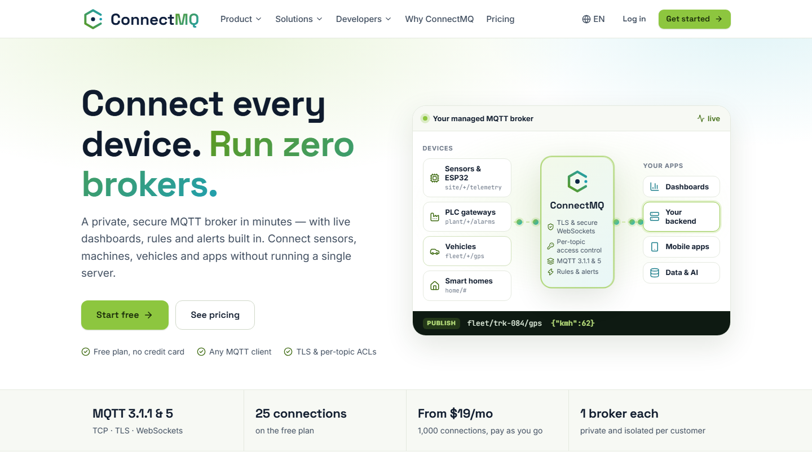
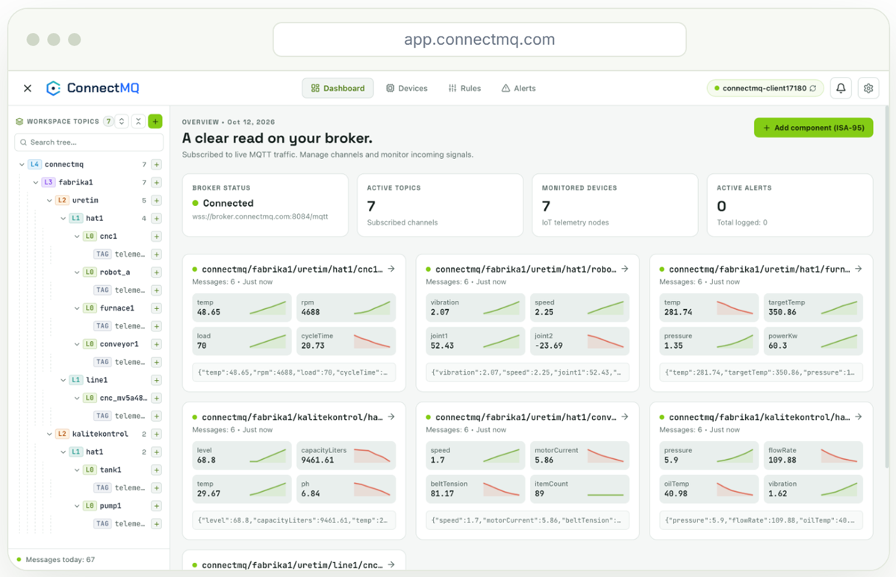
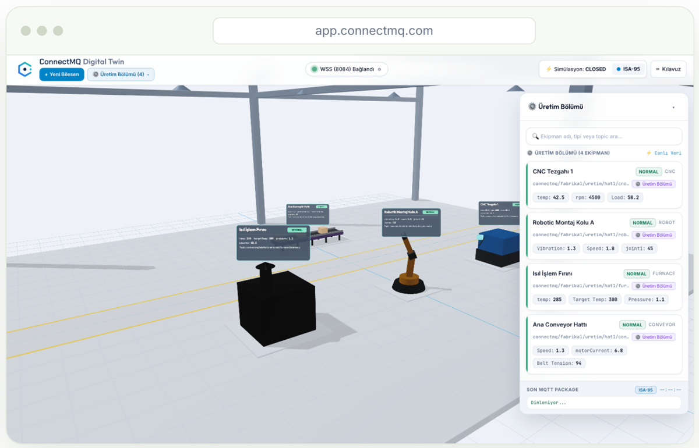
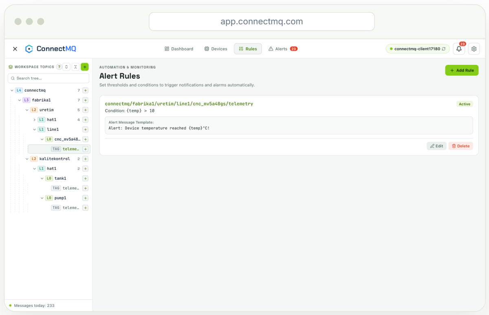
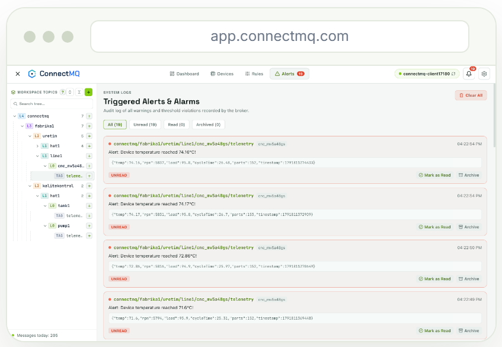
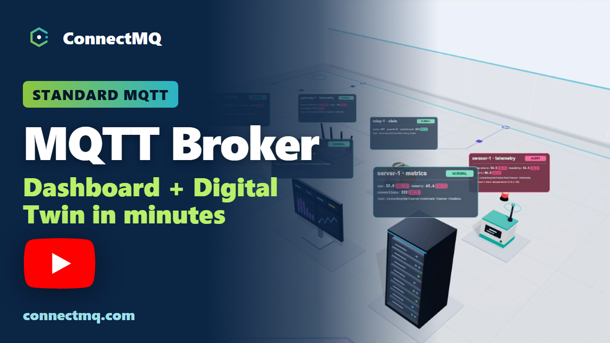
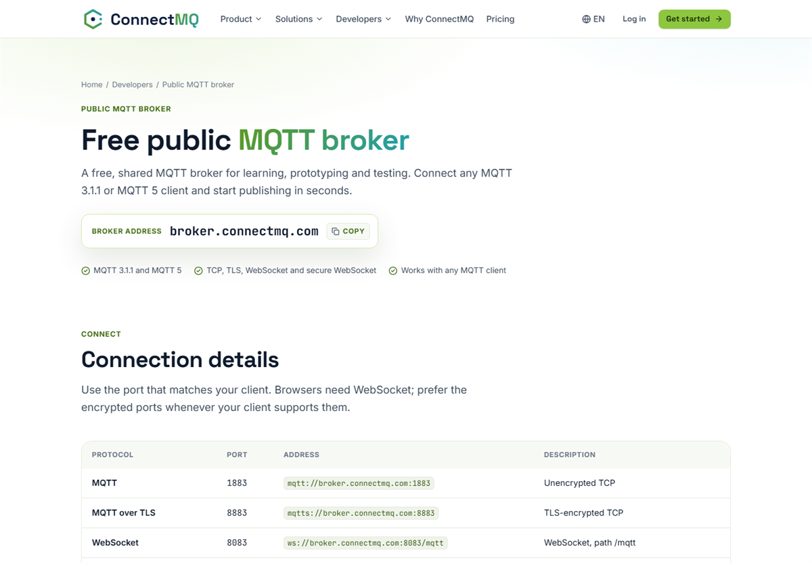

<div align="center">

# ConnectMQ

### Connect every device. Run zero brokers.

A private, secure **managed MQTT broker** in minutes — with live dashboards, rules and alerts built in.<br>
Connect sensors, machines, vehicles and apps without running a single server.

[](https://connectmq.com/?utm_source=github&utm_medium=profile&utm_campaign=github-profile&utm_content=badge)
[](https://app.connectmq.com/signup?utm_source=github&utm_medium=profile&utm_campaign=github-profile&utm_content=badge)
[](https://github.com/connectmq/mqtt-code-samples)
[](https://connectmq.com/connectivity/?utm_source=github&utm_medium=profile&utm_campaign=github-profile&utm_content=badge)

<a href="https://connectmq.com/?utm_source=github&utm_medium=profile&utm_campaign=github-profile&utm_content=screenshot">
  
</a>

**[Start free](https://app.connectmq.com/signup?utm_source=github&utm_medium=profile&utm_campaign=github-profile&utm_content=hero)** · [Pricing](https://connectmq.com/pricing/?utm_source=github&utm_medium=profile&utm_campaign=github-profile&utm_content=hero) · [Code samples](https://github.com/connectmq/mqtt-code-samples) · [Free public broker](https://connectmq.com/public-mqtt-broker/?utm_source=github&utm_medium=profile&utm_campaign=github-profile&utm_content=hero) · [Run in your cloud (BYOC)](https://github.com/connectmq/connectmq-broker-docker) · [Migration skills](#mqtt-broker-migration-skills-for-ai-agents)

</div>

---

## Why ConnectMQ

| | |
| --- | --- |
| ☁️ **Fully managed & serverless** | No servers to install, patch or scale. Your broker is ready in under a minute. |
| 🔐 **Private by default** | Every customer gets an isolated broker. TLS and secure WebSockets, a username and password per device. |
| 🛡️ **Per-topic access control (ACL)** | Decide which client may publish or subscribe to which topic — per username or client ID, with `${clientid}` / `${username}` placeholders. |
| 📊 **Live dashboards** | See every device and connection: online status, last values, message rates and connection history. |
| 🏭 **ISA-95 topic organisation** | Organise topics the way your plant is organised — enterprise, site, area, line, equipment. |
| 🔔 **Rules & alerts** | Turn thresholds on JSON payload fields into alerts, with message templates, browser notifications and an audit log. |
| 🧊 **3D Digital Twin** | Bind machines to their MQTT topics and see your factory in 3D, live. |
| 🔌 **Standard MQTT, no lock-in** | MQTT 3.1.1 and MQTT 5 over TCP, TLS and WebSockets. Use any MQTT client — no SDK required. |

## A look inside ConnectMQ

<table>
  <tr>
    <td width="50%" valign="top"><a href="https://connectmq.com/monitoring/?utm_source=github&utm_medium=profile&utm_campaign=github-profile&utm_content=gallery"></a><br><b>Live dashboard</b> — broker status, ISA-95 topic tree and a live card for every topic</td>
    <td width="50%" valign="top"><a href="https://connectmq.com/digital-twin/?utm_source=github&utm_medium=profile&utm_campaign=github-profile&utm_content=gallery"></a><br><b>3D Digital Twin</b> — machines bound to their MQTT topics, telemetry on the equipment</td>
  </tr>
  <tr>
    <td width="50%" valign="top"><a href="https://connectmq.com/rules-alerts/?utm_source=github&utm_medium=profile&utm_campaign=github-profile&utm_content=gallery"></a><br><b>Rules</b> — thresholds on JSON payload fields, such as <code>{temp} &gt; 70</code></td>
    <td width="50%" valign="top"><a href="https://connectmq.com/rules-alerts/?utm_source=github&utm_medium=profile&utm_campaign=github-profile&utm_content=gallery"></a><br><b>Alerts</b> — audit log with the exact payload, plus browser notifications</td>
  </tr>
</table>

## Watch: MQTT broker with live dashboard & digital twin in minutes

<p align="center"><a href="https://www.youtube.com/watch?v=lLoYWwdXbS0"></a></p>

In under three minutes: create device credentials, add MQTT topics, stream live data to the dashboard, see your devices in the 3D digital twin and fire an alert. **[▶ Watch on YouTube](https://www.youtube.com/watch?v=lLoYWwdXbS0)**

## Get started in 3 steps

1. **[Create a free account](https://app.connectmq.com/signup?utm_source=github&utm_medium=profile&utm_campaign=github-profile&utm_content=steps)** — the Free plan needs no credit card.
2. **Create a broker** and copy its host, username and password from the dashboard.
3. **Connect your device** with any MQTT client — pick your language in the [code samples](https://github.com/connectmq/mqtt-code-samples).

## Code samples

Ready-to-run examples in **[connectmq/mqtt-code-samples](https://github.com/connectmq/mqtt-code-samples)** — each one works on the free public broker right away and on your private ConnectMQ broker by changing only the host and credentials.

| Language / platform | Library | Code | Guide |
| --- | --- | --- | --- |
| Python | paho-mqtt 2.x | [GitHub](https://github.com/connectmq/mqtt-code-samples/tree/main/python) | [connectmq.com](https://connectmq.com/code-samples/python/?utm_source=github&utm_medium=profile&utm_campaign=github-profile&utm_content=python) |
| Node.js | MQTT.js 5 | [GitHub](https://github.com/connectmq/mqtt-code-samples/tree/main/nodejs) | [connectmq.com](https://connectmq.com/code-samples/nodejs/?utm_source=github&utm_medium=profile&utm_campaign=github-profile&utm_content=nodejs) |
| ESP32 | PubSubClient (Arduino) | [GitHub](https://github.com/connectmq/mqtt-code-samples/tree/main/esp32) | [connectmq.com](https://connectmq.com/code-samples/esp32/?utm_source=github&utm_medium=profile&utm_campaign=github-profile&utm_content=esp32) |
| Go | Eclipse Paho Go | [GitHub](https://github.com/connectmq/mqtt-code-samples/tree/main/go) | [connectmq.com](https://connectmq.com/code-samples/go/?utm_source=github&utm_medium=profile&utm_campaign=github-profile&utm_content=go) |
| CLI (mosquitto) | mosquitto_pub / mosquitto_sub | [GitHub](https://github.com/connectmq/mqtt-code-samples/tree/main/cli) | [connectmq.com](https://connectmq.com/code-samples/cli/?utm_source=github&utm_medium=profile&utm_campaign=github-profile&utm_content=cli) |
| Java | Eclipse Paho Java Client | [GitHub](https://github.com/connectmq/mqtt-code-samples/tree/main/java) | [connectmq.com](https://connectmq.com/code-samples/java/?utm_source=github&utm_medium=profile&utm_campaign=github-profile&utm_content=java) |
| C# (.NET) | MQTTnet 4 | [GitHub](https://github.com/connectmq/mqtt-code-samples/tree/main/csharp) | [connectmq.com](https://connectmq.com/code-samples/csharp/?utm_source=github&utm_medium=profile&utm_campaign=github-profile&utm_content=csharp) |
| Rust | rumqttc | [GitHub](https://github.com/connectmq/mqtt-code-samples/tree/main/rust) | [connectmq.com](https://connectmq.com/code-samples/rust/?utm_source=github&utm_medium=profile&utm_campaign=github-profile&utm_content=rust) |
| Dart (Flutter) | mqtt_client | [GitHub](https://github.com/connectmq/mqtt-code-samples/tree/main/dart-flutter) | [connectmq.com](https://connectmq.com/code-samples/dart-flutter/?utm_source=github&utm_medium=profile&utm_campaign=github-profile&utm_content=dart-flutter) |
| Swift / Kotlin | CocoaMQTT (iOS) · HiveMQ MQTT Client (Android) | [GitHub](https://github.com/connectmq/mqtt-code-samples/tree/main/swift-kotlin) | [connectmq.com](https://connectmq.com/code-samples/swift-kotlin/?utm_source=github&utm_medium=profile&utm_campaign=github-profile&utm_content=swift-kotlin) |
| Home Assistant | MQTT integration | [GitHub](https://github.com/connectmq/mqtt-code-samples/tree/main/home-assistant) | [connectmq.com](https://connectmq.com/code-samples/home-assistant/?utm_source=github&utm_medium=profile&utm_campaign=github-profile&utm_content=home-assistant) |
| Node-RED | mqtt in / mqtt out nodes | [GitHub](https://github.com/connectmq/mqtt-code-samples/tree/main/node-red) | [connectmq.com](https://connectmq.com/code-samples/node-red/?utm_source=github&utm_medium=profile&utm_campaign=github-profile&utm_content=node-red) |

## Try it now: the free public MQTT broker

No sign-up, no setup — point any MQTT client at `broker.connectmq.com`:

<p align="center"><a href="https://connectmq.com/public-mqtt-broker/?utm_source=github&utm_medium=profile&utm_campaign=github-profile&utm_content=public-shot"></a></p>

| Protocol | URL |
| --- | --- |
| MQTT (TCP) | `mqtt://broker.connectmq.com:1883` |
| MQTT over TLS | `mqtts://broker.connectmq.com:8883` |
| WebSocket | `ws://broker.connectmq.com:8083/mqtt` |
| Secure WebSocket | `wss://broker.connectmq.com:8084/mqtt` |

```bash
# Terminal 1: subscribe
mosquitto_sub -h broker.connectmq.com -p 1883 -t "your-project/sensors/#" -v

# Terminal 2: publish
mosquitto_pub -h broker.connectmq.com -p 1883 -t "your-project/sensors/temperature" -m '{"temperature":21.5}'
```

> ⚠️ The public broker is **shared**: anyone can subscribe to any topic. Use a unique topic prefix and never send confidential data. For real devices, use a [private ConnectMQ broker](https://app.connectmq.com/signup?utm_source=github&utm_medium=profile&utm_campaign=github-profile&utm_content=public-warning). [About the public broker](https://connectmq.com/public-mqtt-broker/?utm_source=github&utm_medium=profile&utm_campaign=github-profile&utm_content=public-warning)

## Public vs. private broker

| | Free public broker | Private broker on ConnectMQ |
| --- | --- | --- |
| Account | Not needed | Free sign-up, no credit card |
| Who can read your topics | **Anyone** | Only your devices |
| Encryption | Optional (TLS on 8883) | TLS on every connection |
| Authentication | None | Username and password per device |
| Topic access control (ACL) | No | Yes, per topic and per client |
| Dashboards, rules & alerts | No | Yes |
| Use it for | Learning, demos, quick tests | Real devices and production |

## Plans

| Plan | Price | Session minutes | Concurrent connections | Max message size |
| --- | --- | --- | --- | --- |
| **Free** | $0 — no credit card | 10,000 in total (one-time) | 5 | 256 KB |
| **Basic** | $39/mo | 1,000,000 / month | 100 | 256 KB |
| **Scale** | $199/mo | 10,000,000 / month | 1,000 | 1 MB |

Basic and Scale are billed monthly: cancel anytime, 30-day money-back guarantee. Prices in USD, excluding VAT.

See all details on the [pricing page](https://connectmq.com/pricing/?utm_source=github&utm_medium=profile&utm_campaign=github-profile&utm_content=plans).

## Run the broker in your own cloud (BYOC)

Keep message traffic on infrastructure you control: run a ConnectMQ broker node as a container in **AWS, Azure, Google Cloud, Kubernetes or any Docker host**, while ConnectMQ manages authentication, ACLs, quotas and usage reporting. Multi-arch image (`linux/amd64`, `linux/arm64`), runs as a non-root user.

```bash
docker pull connectmqcom/broker:latest        # Docker Hub
docker pull ghcr.io/connectmq/broker:latest   # GitHub Container Registry
```

| | |
| --- | --- |
| 📖 **BYOC documentation** | [connectmq/connectmq-broker-docker](https://github.com/connectmq/connectmq-broker-docker): ports, environment variables, TLS, sizing, troubleshooting |
| ☁️ **Deployment guides** | [Docker Compose](https://github.com/connectmq/connectmq-broker-docker#1-docker--docker-compose-any-vm-or-on-premises-server) · [AWS (ECS Fargate + NLB, EC2)](https://github.com/connectmq/connectmq-broker-docker#2-aws) · [Azure (ACI, Container Apps, VM)](https://github.com/connectmq/connectmq-broker-docker#3-microsoft-azure) · [Google Cloud (GCE, GKE)](https://github.com/connectmq/connectmq-broker-docker#4-google-cloud) |
| 🐳 **Docker Hub** | [connectmqcom/broker](https://hub.docker.com/r/connectmqcom/broker) |
| 📦 **GitHub package** | [ghcr.io/connectmq/broker](https://github.com/connectmq/connectmq-broker-docker/pkgs/container/broker) |

## MQTT broker migration skills for AI agents

Moving to ConnectMQ from another broker or cloud IoT service? These skills give your AI coding agent (Claude Code, Claude.ai or any agent that reads `SKILL.md`) the playbook of an MQTT migration engineer: audit your current setup, convert ACLs and permissions, plan the migration, bridge both brokers, move clients in waves and roll back if needed.

| Migrating from | Skills repository |
| --- | --- |
| HiveMQ (CE, Enterprise, Cloud) | [connectmq/hivemq-migration-skills](https://github.com/connectmq/hivemq-migration-skills) |
| Eclipse Mosquitto | [connectmq/mosquitto-migration-skills](https://github.com/connectmq/mosquitto-migration-skills) |
| EMQX | [connectmq/emqx-migration-skills](https://github.com/connectmq/emqx-migration-skills) |
| VerneMQ | [connectmq/vernemq-migration-skills](https://github.com/connectmq/vernemq-migration-skills) |
| AWS IoT Core | [connectmq/aws-iot-core-migration-skills](https://github.com/connectmq/aws-iot-core-migration-skills) |
| Azure IoT Hub | [connectmq/azure-iot-hub-migration-skills](https://github.com/connectmq/azure-iot-hub-migration-skills) |

Install in Claude Code, for example: `/plugin marketplace add connectmq/hivemq-migration-skills`. Each repository's README covers manual and Claude.ai installation.

## Built for

[Industrial IoT](https://connectmq.com/industrial-iot/?utm_source=github&utm_medium=profile&utm_campaign=github-profile&utm_content=solutions) ·
[Smart Home](https://connectmq.com/smart-home/?utm_source=github&utm_medium=profile&utm_campaign=github-profile&utm_content=solutions) ·
[Fleet & Logistics](https://connectmq.com/fleet-logistics/?utm_source=github&utm_medium=profile&utm_campaign=github-profile&utm_content=solutions) ·
[Energy & Utilities](https://connectmq.com/energy-utilities/?utm_source=github&utm_medium=profile&utm_campaign=github-profile&utm_content=solutions) ·
[Connected Products](https://connectmq.com/connected-products/?utm_source=github&utm_medium=profile&utm_campaign=github-profile&utm_content=solutions) ·
[Prototyping & Education](https://connectmq.com/prototyping-education/?utm_source=github&utm_medium=profile&utm_campaign=github-profile&utm_content=solutions)

## Learn more

- 📘 [Developer quickstart](https://connectmq.com/developers/?utm_source=github&utm_medium=profile&utm_campaign=github-profile&utm_content=learn)
- 🔐 [Security](https://connectmq.com/security/?utm_source=github&utm_medium=profile&utm_campaign=github-profile&utm_content=learn)
- 🔌 [Connectivity](https://connectmq.com/connectivity/?utm_source=github&utm_medium=profile&utm_campaign=github-profile&utm_content=learn)
- 🧊 [Digital Twin](https://connectmq.com/digital-twin/?utm_source=github&utm_medium=profile&utm_campaign=github-profile&utm_content=learn)
- ✍️ [Blog](https://connectmq.com/blog/?utm_source=github&utm_medium=profile&utm_campaign=github-profile&utm_content=learn)


## MQTT tutorials

**58 step-by-step projects** with ready-to-run code: Python, JavaScript/TypeScript, React, Vue, Angular and Next.js, mobile and desktop apps (Android, iOS, Flutter, .NET MAUI, Qt, Unity), backend languages, ESP32 and other embedded devices, databases and time series (InfluxDB, TimescaleDB, MongoDB, SQLite), Grafana and Telegraf, plus CLI and testing tools. Each one runs on the free public broker and on your private ConnectMQ broker.

👉 **[Browse all MQTT tutorials](https://github.com/connectmq/mqtt-code-samples/tree/main/tutorials)** · [Read them on the ConnectMQ blog](https://connectmq.com/blog/category/iot-tutorials/?utm_source=github&utm_medium=profile&utm_campaign=github-profile&utm_content=tutorials)

---

<p align="center">
  <a href="https://connectmq.com/?utm_source=github&utm_medium=profile&utm_campaign=github-profile&utm_content=footer"><b>connectmq.com</b></a> ·
  <a href="https://app.connectmq.com/signup?utm_source=github&utm_medium=profile&utm_campaign=github-profile&utm_content=footer">Start free</a> ·
  <a href="https://connectmq.com/why-connectmq/?utm_source=github&utm_medium=profile&utm_campaign=github-profile&utm_content=footer">Why ConnectMQ</a> ·
  <a href="https://github.com/connectmq/mqtt-code-samples">Code samples</a> ·
  <a href="https://github.com/connectmq/connectmq-broker-docker">BYOC / Docker</a>
</p>
