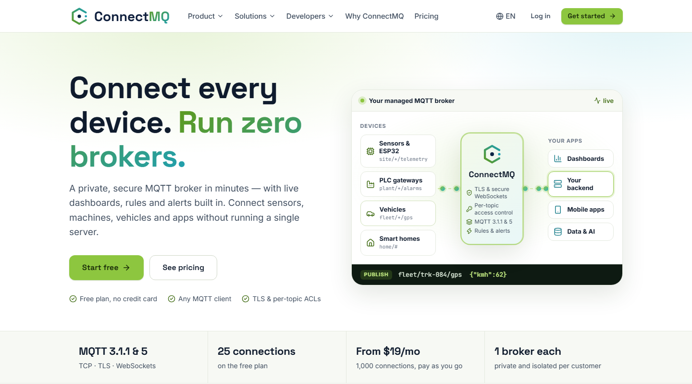
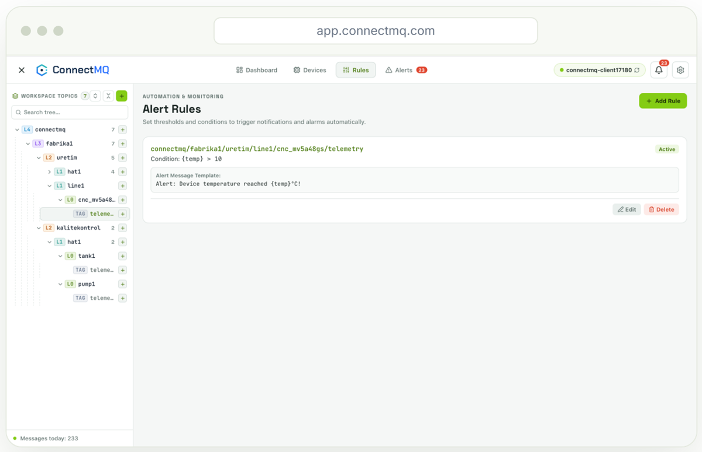
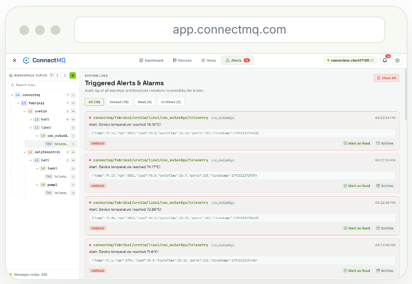

<div align="center">

# ConnectMQ

### Connect every device. Run zero brokers.

A private, secure **managed MQTT broker** in minutes — with live dashboards, rules and alerts built in.<br>
Connect sensors, machines, vehicles and apps without running a single server.

[](https://connectmq.com/?utm_source=github&utm_medium=profile&utm_campaign=github-profile&utm_content=badge)
[](https://app.connectmq.com/signup?utm_source=github&utm_medium=profile&utm_campaign=github-profile&utm_content=badge)
[](https://github.com/connectmq/mqtt-code-samples)
[](https://connectmq.com/connectivity/?utm_source=github&utm_medium=profile&utm_campaign=github-profile&utm_content=badge)

<a href="https://connectmq.com/?utm_source=github&utm_medium=profile&utm_campaign=github-profile&utm_content=screenshot">
  
</a>

**[Start free](https://app.connectmq.com/signup?utm_source=github&utm_medium=profile&utm_campaign=github-profile&utm_content=hero)** · [Pricing](https://connectmq.com/pricing/?utm_source=github&utm_medium=profile&utm_campaign=github-profile&utm_content=hero) · [Code samples](https://github.com/connectmq/mqtt-code-samples) · [Free public broker](https://connectmq.com/public-mqtt-broker/?utm_source=github&utm_medium=profile&utm_campaign=github-profile&utm_content=hero)

</div>

---

## Why ConnectMQ

| | |
| --- | --- |
| ☁️ **Fully managed & serverless** | No servers to install, patch or scale. Your broker is ready in under a minute. |
| 🔐 **Private by default** | Every customer gets an isolated broker. TLS and secure WebSockets, a username and password per device. |
| 🛡️ **Per-topic access control (ACL)** | Decide which client may publish or subscribe to which topic — per username or client ID, with `${clientid}` / `${username}` placeholders. |
| 📊 **Live dashboards** | See every device and connection: online status, last values, message rates and connection history. |
| 🏭 **ISA-95 topic organisation** | Organise topics the way your plant is organised — enterprise, site, area, line, equipment. |
| 🔔 **Rules & alerts** | Turn thresholds on JSON payload fields into alerts, with message templates, browser notifications and an audit log. |
| 🧊 **3D Digital Twin** | Bind machines to their MQTT topics and see your factory in 3D, live. |
| 🔌 **Standard MQTT, no lock-in** | MQTT 3.1.1 and MQTT 5 over TCP, TLS and WebSockets. Use any MQTT client — no SDK required. |

## A look inside ConnectMQ

<table>
  <tr>
    <td width="50%" valign="top"><a href="https://connectmq.com/monitoring/?utm_source=github&utm_medium=profile&utm_campaign=github-profile&utm_content=gallery"></a><br><b>Live dashboard</b> — broker status, ISA-95 topic tree and a live card for every topic</td>
    <td width="50%" valign="top"><a href="https://connectmq.com/digital-twin/?utm_source=github&utm_medium=profile&utm_campaign=github-profile&utm_content=gallery"></a><br><b>3D Digital Twin</b> — machines bound to their MQTT topics, telemetry on the equipment</td>
  </tr>
  <tr>
    <td width="50%" valign="top"><a href="https://connectmq.com/rules-alerts/?utm_source=github&utm_medium=profile&utm_campaign=github-profile&utm_content=gallery"></a><br><b>Rules</b> — thresholds on JSON payload fields, such as <code>{temp} &gt; 70</code></td>
    <td width="50%" valign="top"><a href="https://connectmq.com/rules-alerts/?utm_source=github&utm_medium=profile&utm_campaign=github-profile&utm_content=gallery"></a><br><b>Alerts</b> — audit log with the exact payload, plus browser notifications</td>
  </tr>
</table>

## Get started in 3 steps

1. **[Create a free account](https://app.connectmq.com/signup?utm_source=github&utm_medium=profile&utm_campaign=github-profile&utm_content=steps)** — the Free plan needs no credit card.
2. **Create a broker** and copy its host, username and password from the dashboard.
3. **Connect your device** with any MQTT client — pick your language in the [code samples](https://github.com/connectmq/mqtt-code-samples).

## Code samples

Ready-to-run examples in **[connectmq/mqtt-code-samples](https://github.com/connectmq/mqtt-code-samples)** — each one works on the free public broker right away and on your private ConnectMQ broker by changing only the host and credentials.

| Language / platform | Library | Code | Guide |
| --- | --- | --- | --- |
| Python | paho-mqtt 2.x | [GitHub](https://github.com/connectmq/mqtt-code-samples/tree/main/python) | [connectmq.com](https://connectmq.com/code-samples/python/?utm_source=github&utm_medium=profile&utm_campaign=github-profile&utm_content=python) |
| Node.js | MQTT.js 5 | [GitHub](https://github.com/connectmq/mqtt-code-samples/tree/main/nodejs) | [connectmq.com](https://connectmq.com/code-samples/nodejs/?utm_source=github&utm_medium=profile&utm_campaign=github-profile&utm_content=nodejs) |
| ESP32 | PubSubClient (Arduino) | [GitHub](https://github.com/connectmq/mqtt-code-samples/tree/main/esp32) | [connectmq.com](https://connectmq.com/code-samples/esp32/?utm_source=github&utm_medium=profile&utm_campaign=github-profile&utm_content=esp32) |
| Go | Eclipse Paho Go | [GitHub](https://github.com/connectmq/mqtt-code-samples/tree/main/go) | [connectmq.com](https://connectmq.com/code-samples/go/?utm_source=github&utm_medium=profile&utm_campaign=github-profile&utm_content=go) |
| CLI (mosquitto) | mosquitto_pub / mosquitto_sub | [GitHub](https://github.com/connectmq/mqtt-code-samples/tree/main/cli) | [connectmq.com](https://connectmq.com/code-samples/cli/?utm_source=github&utm_medium=profile&utm_campaign=github-profile&utm_content=cli) |
| Java | Eclipse Paho Java Client | [GitHub](https://github.com/connectmq/mqtt-code-samples/tree/main/java) | [connectmq.com](https://connectmq.com/code-samples/java/?utm_source=github&utm_medium=profile&utm_campaign=github-profile&utm_content=java) |
| C# (.NET) | MQTTnet 4 | [GitHub](https://github.com/connectmq/mqtt-code-samples/tree/main/csharp) | [connectmq.com](https://connectmq.com/code-samples/csharp/?utm_source=github&utm_medium=profile&utm_campaign=github-profile&utm_content=csharp) |
| Rust | rumqttc | [GitHub](https://github.com/connectmq/mqtt-code-samples/tree/main/rust) | [connectmq.com](https://connectmq.com/code-samples/rust/?utm_source=github&utm_medium=profile&utm_campaign=github-profile&utm_content=rust) |
| Dart (Flutter) | mqtt_client | [GitHub](https://github.com/connectmq/mqtt-code-samples/tree/main/dart-flutter) | [connectmq.com](https://connectmq.com/code-samples/dart-flutter/?utm_source=github&utm_medium=profile&utm_campaign=github-profile&utm_content=dart-flutter) |
| Swift / Kotlin | CocoaMQTT (iOS) · HiveMQ MQTT Client (Android) | [GitHub](https://github.com/connectmq/mqtt-code-samples/tree/main/swift-kotlin) | [connectmq.com](https://connectmq.com/code-samples/swift-kotlin/?utm_source=github&utm_medium=profile&utm_campaign=github-profile&utm_content=swift-kotlin) |
| Home Assistant | MQTT integration | [GitHub](https://github.com/connectmq/mqtt-code-samples/tree/main/home-assistant) | [connectmq.com](https://connectmq.com/code-samples/home-assistant/?utm_source=github&utm_medium=profile&utm_campaign=github-profile&utm_content=home-assistant) |
| Node-RED | mqtt in / mqtt out nodes | [GitHub](https://github.com/connectmq/mqtt-code-samples/tree/main/node-red) | [connectmq.com](https://connectmq.com/code-samples/node-red/?utm_source=github&utm_medium=profile&utm_campaign=github-profile&utm_content=node-red) |

## Try it now: the free public MQTT broker

No sign-up, no setup — point any MQTT client at `broker.connectmq.com`:

<p align="center"><a href="https://connectmq.com/public-mqtt-broker/?utm_source=github&utm_medium=profile&utm_campaign=github-profile&utm_content=public-shot"></a></p>

| Protocol | URL |
| --- | --- |
| MQTT (TCP) | `mqtt://broker.connectmq.com:1883` |
| MQTT over TLS | `mqtts://broker.connectmq.com:8883` |
| WebSocket | `ws://broker.connectmq.com:8083/mqtt` |
| Secure WebSocket | `wss://broker.connectmq.com:8084/mqtt` |

```bash
# Terminal 1: subscribe
mosquitto_sub -h broker.connectmq.com -p 1883 -t "your-project/sensors/#" -v

# Terminal 2: publish
mosquitto_pub -h broker.connectmq.com -p 1883 -t "your-project/sensors/temperature" -m '{"temperature":21.5}'
```

> ⚠️ The public broker is **shared**: anyone can subscribe to any topic. Use a unique topic prefix and never send confidential data. For real devices, use a [private ConnectMQ broker](https://app.connectmq.com/signup?utm_source=github&utm_medium=profile&utm_campaign=github-profile&utm_content=public-warning). [About the public broker](https://connectmq.com/public-mqtt-broker/?utm_source=github&utm_medium=profile&utm_campaign=github-profile&utm_content=public-warning)

## Public vs. private broker

| | Free public broker | Private broker on ConnectMQ |
| --- | --- | --- |
| Account | Not needed | Free sign-up, no credit card |
| Who can read your topics | **Anyone** | Only your devices |
| Encryption | Optional (TLS on 8883) | TLS on every connection |
| Authentication | None | Username and password per device |
| Topic access control (ACL) | No | Yes, per topic and per client |
| Dashboards, rules & alerts | No | Yes |
| Use it for | Learning, demos, quick tests | Real devices and production |

## Plans

| Plan | Price | Session minutes | Concurrent connections | Max message size |
| --- | --- | --- | --- | --- |
| **Free** | $0 — no credit card | 10,000 in total (one-time) | 5 | 256 KB |
| **Basic** | $39/mo | 1,000,000 / month | 100 | 256 KB |
| **Scale** | $199/mo | 10,000,000 / month | 1,000 | 1 MB |

Basic and Scale are billed monthly: cancel anytime, 30-day money-back guarantee. Prices in USD, excluding VAT.

See all details on the [pricing page](https://connectmq.com/pricing/?utm_source=github&utm_medium=profile&utm_campaign=github-profile&utm_content=plans).

## Built for

[Industrial IoT](https://connectmq.com/industrial-iot/?utm_source=github&utm_medium=profile&utm_campaign=github-profile&utm_content=solutions) ·
[Smart Home](https://connectmq.com/smart-home/?utm_source=github&utm_medium=profile&utm_campaign=github-profile&utm_content=solutions) ·
[Fleet & Logistics](https://connectmq.com/fleet-logistics/?utm_source=github&utm_medium=profile&utm_campaign=github-profile&utm_content=solutions) ·
[Energy & Utilities](https://connectmq.com/energy-utilities/?utm_source=github&utm_medium=profile&utm_campaign=github-profile&utm_content=solutions) ·
[Connected Products](https://connectmq.com/connected-products/?utm_source=github&utm_medium=profile&utm_campaign=github-profile&utm_content=solutions) ·
[Prototyping & Education](https://connectmq.com/prototyping-education/?utm_source=github&utm_medium=profile&utm_campaign=github-profile&utm_content=solutions)

## Learn more

- 📘 [Developer quickstart](https://connectmq.com/developers/?utm_source=github&utm_medium=profile&utm_campaign=github-profile&utm_content=learn)
- 🔐 [Security](https://connectmq.com/security/?utm_source=github&utm_medium=profile&utm_campaign=github-profile&utm_content=learn)
- 🔌 [Connectivity](https://connectmq.com/connectivity/?utm_source=github&utm_medium=profile&utm_campaign=github-profile&utm_content=learn)
- 🧊 [Digital Twin](https://connectmq.com/digital-twin/?utm_source=github&utm_medium=profile&utm_campaign=github-profile&utm_content=learn)
- ✍️ [Blog](https://connectmq.com/blog/?utm_source=github&utm_medium=profile&utm_campaign=github-profile&utm_content=learn)


## MQTT tutorials

58 complete projects from the [ConnectMQ blog](https://connectmq.com/blog/category/iot-tutorials/?utm_source=github&utm_medium=profile&utm_campaign=github-profile&utm_content=tutorials), with ready-to-run code in [connectmq/mqtt-code-samples](https://github.com/connectmq/mqtt-code-samples/tree/main/tutorials). Each one runs on the free public broker and on your private ConnectMQ broker.

### 🐍 Python

| Tutorial | Stack | Code | Full guide |
| --- | --- | --- | --- |
| **[Paho MQTT Python Tutorial: Publish and Subscribe in 10 Minutes](https://github.com/connectmq/mqtt-code-samples/tree/main/tutorials/paho-mqtt-python/)** | Python | [`paho-mqtt-python/`](https://github.com/connectmq/mqtt-code-samples/tree/main/tutorials/paho-mqtt-python/) | [Read on connectmq.com](https://connectmq.com/blog/paho-mqtt-python/?utm_source=github&utm_medium=profile&utm_campaign=github-profile&utm_content=tut-paho-mqtt-python) |
| **[Paho MQTT 2.0 Callback API Version: Fixing Migration Errors Step by Step](https://github.com/connectmq/mqtt-code-samples/tree/main/tutorials/paho-mqtt-2-0-callback-api-version/)** | Python | [`paho-mqtt-2-0-callback-api-version/`](https://github.com/connectmq/mqtt-code-samples/tree/main/tutorials/paho-mqtt-2-0-callback-api-version/) | [Read on connectmq.com](https://connectmq.com/blog/paho-mqtt-2-0-callback-api-version/?utm_source=github&utm_medium=profile&utm_campaign=github-profile&utm_content=tut-paho-mqtt-2-0-callback-api-version) |
| **[Paho MQTT Reconnect: Robust Backoff, Resubscribe and Offline Buffering in Python](https://github.com/connectmq/mqtt-code-samples/tree/main/tutorials/paho-mqtt-reconnect/)** | Python | [`paho-mqtt-reconnect/`](https://github.com/connectmq/mqtt-code-samples/tree/main/tutorials/paho-mqtt-reconnect/) | [Read on connectmq.com](https://connectmq.com/blog/paho-mqtt-reconnect/?utm_source=github&utm_medium=profile&utm_campaign=github-profile&utm_content=tut-paho-mqtt-reconnect) |
| **[Python MQTT JSON: Publishing Sensor Data with Timestamps and Schema Versions](https://github.com/connectmq/mqtt-code-samples/tree/main/tutorials/python-mqtt-json/)** | Python | [`python-mqtt-json/`](https://github.com/connectmq/mqtt-code-samples/tree/main/tutorials/python-mqtt-json/) | [Read on connectmq.com](https://connectmq.com/blog/python-mqtt-json/?utm_source=github&utm_medium=profile&utm_campaign=github-profile&utm_content=tut-python-mqtt-json) |
| **[Python MQTT TLS: Connecting Securely on Port 8883 with paho-mqtt](https://github.com/connectmq/mqtt-code-samples/tree/main/tutorials/python-mqtt-tls/)** | Python | [`python-mqtt-tls/`](https://github.com/connectmq/mqtt-code-samples/tree/main/tutorials/python-mqtt-tls/) | [Read on connectmq.com](https://connectmq.com/blog/python-mqtt-tls/?utm_source=github&utm_medium=profile&utm_campaign=github-profile&utm_content=tut-python-mqtt-tls) |
| **[Async MQTT in Python with aiomqtt and asyncio: Tasks, Workers and Reconnects](https://github.com/connectmq/mqtt-code-samples/tree/main/tutorials/aiomqtt-asyncio/)** | Python | [`aiomqtt-asyncio/`](https://github.com/connectmq/mqtt-code-samples/tree/main/tutorials/aiomqtt-asyncio/) | [Read on connectmq.com](https://connectmq.com/blog/aiomqtt-asyncio/?utm_source=github&utm_medium=profile&utm_campaign=github-profile&utm_content=tut-aiomqtt-asyncio) |
| **[Build an MQTT Device Simulator in Python for Hundreds of Virtual Sensors](https://github.com/connectmq/mqtt-code-samples/tree/main/tutorials/mqtt-device-simulator/)** | Python | [`mqtt-device-simulator/`](https://github.com/connectmq/mqtt-code-samples/tree/main/tutorials/mqtt-device-simulator/) | [Read on connectmq.com](https://connectmq.com/blog/mqtt-device-simulator/?utm_source=github&utm_medium=profile&utm_campaign=github-profile&utm_content=tut-mqtt-device-simulator) |
| **[Log MQTT Messages to CSV with Python for Quick Analysis](https://github.com/connectmq/mqtt-code-samples/tree/main/tutorials/log-mqtt-messages-to-csv/)** | Python | [`log-mqtt-messages-to-csv/`](https://github.com/connectmq/mqtt-code-samples/tree/main/tutorials/log-mqtt-messages-to-csv/) | [Read on connectmq.com](https://connectmq.com/blog/log-mqtt-messages-to-csv/?utm_source=github&utm_medium=profile&utm_campaign=github-profile&utm_content=tut-log-mqtt-messages-to-csv) |
| **[Real-Time MQTT Data Analysis with Python and pandas](https://github.com/connectmq/mqtt-code-samples/tree/main/tutorials/mqtt-pandas/)** | Python | [`mqtt-pandas/`](https://github.com/connectmq/mqtt-code-samples/tree/main/tutorials/mqtt-pandas/) | [Read on connectmq.com](https://connectmq.com/blog/mqtt-pandas/?utm_source=github&utm_medium=profile&utm_campaign=github-profile&utm_content=tut-mqtt-pandas) |
| **[Exploring MQTT Data in a Jupyter Notebook: Subscribe, Plot and Save Snapshots](https://github.com/connectmq/mqtt-code-samples/tree/main/tutorials/mqtt-jupyter-notebook/)** | Python (Jupyter) | [`mqtt-jupyter-notebook/`](https://github.com/connectmq/mqtt-code-samples/tree/main/tutorials/mqtt-jupyter-notebook/) | [Read on connectmq.com](https://connectmq.com/blog/mqtt-jupyter-notebook/?utm_source=github&utm_medium=profile&utm_campaign=github-profile&utm_content=tut-mqtt-jupyter-notebook) |
| **[Streamlit MQTT Dashboard in Pure Python: Live Sensor Charts in 100 Lines](https://github.com/connectmq/mqtt-code-samples/tree/main/tutorials/streamlit-mqtt-dashboard/)** | Python (Streamlit) | [`streamlit-mqtt-dashboard/`](https://github.com/connectmq/mqtt-code-samples/tree/main/tutorials/streamlit-mqtt-dashboard/) | [Read on connectmq.com](https://connectmq.com/blog/streamlit-mqtt-dashboard/?utm_source=github&utm_medium=profile&utm_campaign=github-profile&utm_content=tut-streamlit-mqtt-dashboard) |
| **[MQTT to REST API Flask Tutorial: Expose Live Device Data over HTTP](https://github.com/connectmq/mqtt-code-samples/tree/main/tutorials/mqtt-to-rest-api-flask/)** | Python (Flask) | [`mqtt-to-rest-api-flask/`](https://github.com/connectmq/mqtt-code-samples/tree/main/tutorials/mqtt-to-rest-api-flask/) | [Read on connectmq.com](https://connectmq.com/blog/mqtt-to-rest-api-flask/?utm_source=github&utm_medium=profile&utm_campaign=github-profile&utm_content=tut-mqtt-to-rest-api-flask) |
| **[MQTT Email Alerts Python Tutorial: Rate-Limited SMTP Notifications](https://github.com/connectmq/mqtt-code-samples/tree/main/tutorials/mqtt-email-alerts-python/)** | Python | [`mqtt-email-alerts-python/`](https://github.com/connectmq/mqtt-code-samples/tree/main/tutorials/mqtt-email-alerts-python/) | [Read on connectmq.com](https://connectmq.com/blog/mqtt-email-alerts-python/?utm_source=github&utm_medium=profile&utm_campaign=github-profile&utm_content=tut-mqtt-email-alerts-python) |
| **[Build an MQTT Telegram Bot for Device Alerts and Commands](https://github.com/connectmq/mqtt-code-samples/tree/main/tutorials/mqtt-telegram-bot/)** | Python | [`mqtt-telegram-bot/`](https://github.com/connectmq/mqtt-code-samples/tree/main/tutorials/mqtt-telegram-bot/) | [Read on connectmq.com](https://connectmq.com/blog/mqtt-telegram-bot/?utm_source=github&utm_medium=profile&utm_campaign=github-profile&utm_content=tut-mqtt-telegram-bot) |
| **[MQTT to Google Sheets: Send Sensor Data with Python and the Sheets API](https://github.com/connectmq/mqtt-code-samples/tree/main/tutorials/mqtt-to-google-sheets/)** | Python | [`mqtt-to-google-sheets/`](https://github.com/connectmq/mqtt-code-samples/tree/main/tutorials/mqtt-to-google-sheets/) | [Read on connectmq.com](https://connectmq.com/blog/mqtt-to-google-sheets/?utm_source=github&utm_medium=profile&utm_campaign=github-profile&utm_content=tut-mqtt-to-google-sheets) |
| **[Testing MQTT Clients: Unit, Integration and End-to-End Tests](https://github.com/connectmq/mqtt-code-samples/tree/main/tutorials/testing-mqtt-clients/)** | Python (pytest) | [`testing-mqtt-clients/`](https://github.com/connectmq/mqtt-code-samples/tree/main/tutorials/testing-mqtt-clients/) | [Read on connectmq.com](https://connectmq.com/blog/testing-mqtt-clients/?utm_source=github&utm_medium=profile&utm_campaign=github-profile&utm_content=tut-testing-mqtt-clients) |

### 🗄️ Databases & time series

| Tutorial | Stack | Code | Full guide |
| --- | --- | --- | --- |
| **[MQTT to SQLite with Python: Store and Query Sensor Messages](https://github.com/connectmq/mqtt-code-samples/tree/main/tutorials/mqtt-to-sqlite-python/)** | Python | [`mqtt-to-sqlite-python/`](https://github.com/connectmq/mqtt-code-samples/tree/main/tutorials/mqtt-to-sqlite-python/) | [Read on connectmq.com](https://connectmq.com/blog/mqtt-to-sqlite-python/?utm_source=github&utm_medium=profile&utm_campaign=github-profile&utm_content=tut-mqtt-to-sqlite-python) |
| **[MQTT to TimescaleDB: Storing IoT Time Series in PostgreSQL](https://github.com/connectmq/mqtt-code-samples/tree/main/tutorials/mqtt-to-timescaledb/)** | Python, PostgreSQL/TimescaleDB | [`mqtt-to-timescaledb/`](https://github.com/connectmq/mqtt-code-samples/tree/main/tutorials/mqtt-to-timescaledb/) | [Read on connectmq.com](https://connectmq.com/blog/mqtt-to-timescaledb/?utm_source=github&utm_medium=profile&utm_campaign=github-profile&utm_content=tut-mqtt-to-timescaledb) |
| **[How to Store MQTT Data in InfluxDB with Python](https://github.com/connectmq/mqtt-code-samples/tree/main/tutorials/store-mqtt-data-in-influxdb/)** | Python | [`store-mqtt-data-in-influxdb/`](https://github.com/connectmq/mqtt-code-samples/tree/main/tutorials/store-mqtt-data-in-influxdb/) | [Read on connectmq.com](https://connectmq.com/blog/store-mqtt-data-in-influxdb/?utm_source=github&utm_medium=profile&utm_campaign=github-profile&utm_content=tut-store-mqtt-data-in-influxdb) |
| **[MQTT to MongoDB: Save Device Messages with Node.js and Time-Series Collections](https://github.com/connectmq/mqtt-code-samples/tree/main/tutorials/mqtt-to-mongodb/)** | Node.js | [`mqtt-to-mongodb/`](https://github.com/connectmq/mqtt-code-samples/tree/main/tutorials/mqtt-to-mongodb/) | [Read on connectmq.com](https://connectmq.com/blog/mqtt-to-mongodb/?utm_source=github&utm_medium=profile&utm_campaign=github-profile&utm_content=tut-mqtt-to-mongodb) |

### 📈 Grafana, Telegraf & the TIG stack

| Tutorial | Stack | Code | Full guide |
| --- | --- | --- | --- |
| **[TIG Stack with Docker Compose for MQTT Data](https://github.com/connectmq/mqtt-code-samples/tree/main/tutorials/tig-stack-docker-compose/)** | Docker | [`tig-stack-docker-compose/`](https://github.com/connectmq/mqtt-code-samples/tree/main/tutorials/tig-stack-docker-compose/) | [Read on connectmq.com](https://connectmq.com/blog/tig-stack-docker-compose/?utm_source=github&utm_medium=profile&utm_campaign=github-profile&utm_content=tut-tig-stack-docker-compose) |
| **[Telegraf MQTT Consumer: Ingest MQTT Data into InfluxDB](https://github.com/connectmq/mqtt-code-samples/tree/main/tutorials/telegraf-mqtt-consumer/)** | Telegraf / InfluxDB | [`telegraf-mqtt-consumer/`](https://github.com/connectmq/mqtt-code-samples/tree/main/tutorials/telegraf-mqtt-consumer/) | [Read on connectmq.com](https://connectmq.com/blog/telegraf-mqtt-consumer/?utm_source=github&utm_medium=profile&utm_campaign=github-profile&utm_content=tut-telegraf-mqtt-consumer) |
| **[Telegraf json_v2 Parser and MQTT Topic Parsing Explained](https://github.com/connectmq/mqtt-code-samples/tree/main/tutorials/telegraf-json-v2-parser/)** | Telegraf | [`telegraf-json-v2-parser/`](https://github.com/connectmq/mqtt-code-samples/tree/main/tutorials/telegraf-json-v2-parser/) | [Read on connectmq.com](https://connectmq.com/blog/telegraf-json-v2-parser/?utm_source=github&utm_medium=profile&utm_campaign=github-profile&utm_content=tut-telegraf-json-v2-parser) |
| **[Grafana MQTT Datasource: Live Streaming Panels from Your Broker](https://github.com/connectmq/mqtt-code-samples/tree/main/tutorials/grafana-mqtt-datasource/)** | Docker / Grafana | [`grafana-mqtt-datasource/`](https://github.com/connectmq/mqtt-code-samples/tree/main/tutorials/grafana-mqtt-datasource/) | [Read on connectmq.com](https://connectmq.com/blog/grafana-mqtt-datasource/?utm_source=github&utm_medium=profile&utm_campaign=github-profile&utm_content=tut-grafana-mqtt-datasource) |
| **[Grafana Alerts for IoT Sensor Data: Thresholds, Stale Sensors and Notifications](https://github.com/connectmq/mqtt-code-samples/tree/main/tutorials/grafana-alerts-iot-sensor-data/)** | Grafana / InfluxDB (Flux) | [`grafana-alerts-iot-sensor-data/`](https://github.com/connectmq/mqtt-code-samples/tree/main/tutorials/grafana-alerts-iot-sensor-data/) | [Read on connectmq.com](https://connectmq.com/blog/grafana-alerts-iot-sensor-data/?utm_source=github&utm_medium=profile&utm_campaign=github-profile&utm_content=tut-grafana-alerts-iot-sensor-data) |

### 🌐 JavaScript, TypeScript & web apps

| Tutorial | Stack | Code | Full guide |
| --- | --- | --- | --- |
| **[MQTT.js Node.js Tutorial: Publish, Subscribe, QoS and TLS](https://github.com/connectmq/mqtt-code-samples/tree/main/tutorials/mqtt-js-node-js/)** | Node.js | [`mqtt-js-node-js/`](https://github.com/connectmq/mqtt-code-samples/tree/main/tutorials/mqtt-js-node-js/) | [Read on connectmq.com](https://connectmq.com/blog/mqtt-js-node-js/?utm_source=github&utm_medium=profile&utm_campaign=github-profile&utm_content=tut-mqtt-js-node-js) |
| **[Type-Safe MQTT TypeScript Client: Typed Topics and Validated Payloads](https://github.com/connectmq/mqtt-code-samples/tree/main/tutorials/mqtt-typescript/)** | TypeScript, Node.js | [`mqtt-typescript/`](https://github.com/connectmq/mqtt-code-samples/tree/main/tutorials/mqtt-typescript/) | [Read on connectmq.com](https://connectmq.com/blog/mqtt-typescript/?utm_source=github&utm_medium=profile&utm_campaign=github-profile&utm_content=tut-mqtt-typescript) |
| **[MQTT in the Browser with JavaScript: A Minimal Client in One HTML Page](https://github.com/connectmq/mqtt-code-samples/tree/main/tutorials/mqtt-javascript-browser/)** | HTML/JavaScript (MQTT.js, browser) | [`mqtt-javascript-browser/`](https://github.com/connectmq/mqtt-code-samples/tree/main/tutorials/mqtt-javascript-browser/) | [Read on connectmq.com](https://connectmq.com/blog/mqtt-javascript-browser/?utm_source=github&utm_medium=profile&utm_campaign=github-profile&utm_content=tut-mqtt-javascript-browser) |
| **[MQTT over WebSocket: Connect a Browser to an MQTT Broker with MQTT.js](https://github.com/connectmq/mqtt-code-samples/tree/main/tutorials/mqtt-over-websocket/)** | JavaScript (browser + Node.js) | [`mqtt-over-websocket/`](https://github.com/connectmq/mqtt-code-samples/tree/main/tutorials/mqtt-over-websocket/) | [Read on connectmq.com](https://connectmq.com/blog/mqtt-over-websocket/?utm_source=github&utm_medium=profile&utm_campaign=github-profile&utm_content=tut-mqtt-over-websocket) |
| **[Build a Real-Time MQTT Chat App with JavaScript, Presence and No Local](https://github.com/connectmq/mqtt-code-samples/tree/main/tutorials/mqtt-chat-app/)** | JavaScript (browser, MQTT.js) | [`mqtt-chat-app/`](https://github.com/connectmq/mqtt-code-samples/tree/main/tutorials/mqtt-chat-app/) | [Read on connectmq.com](https://connectmq.com/blog/mqtt-chat-app/?utm_source=github&utm_medium=profile&utm_campaign=github-profile&utm_content=tut-mqtt-chat-app) |
| **[React MQTT Tutorial: A Hooks-Based Real-Time Dashboard](https://github.com/connectmq/mqtt-code-samples/tree/main/tutorials/react-mqtt/)** | React (JavaScript) | [`react-mqtt/`](https://github.com/connectmq/mqtt-code-samples/tree/main/tutorials/react-mqtt/) | [Read on connectmq.com](https://connectmq.com/blog/react-mqtt/?utm_source=github&utm_medium=profile&utm_campaign=github-profile&utm_content=tut-react-mqtt) |
| **[Vue MQTT Client: Real-Time Data over WebSocket with Vue 3](https://github.com/connectmq/mqtt-code-samples/tree/main/tutorials/vue-mqtt/)** | Vue 3 (JavaScript, MQTT.js) | [`vue-mqtt/`](https://github.com/connectmq/mqtt-code-samples/tree/main/tutorials/vue-mqtt/) | [Read on connectmq.com](https://connectmq.com/blog/vue-mqtt/?utm_source=github&utm_medium=profile&utm_campaign=github-profile&utm_content=tut-vue-mqtt) |
| **[Angular MQTT Tutorial with RxJS, MQTT.js and ngx-mqtt](https://github.com/connectmq/mqtt-code-samples/tree/main/tutorials/angular-mqtt/)** | TypeScript (Angular) | [`angular-mqtt/`](https://github.com/connectmq/mqtt-code-samples/tree/main/tutorials/angular-mqtt/) | [Read on connectmq.com](https://connectmq.com/blog/angular-mqtt/?utm_source=github&utm_medium=profile&utm_campaign=github-profile&utm_content=tut-angular-mqtt) |
| **[Next.js MQTT: Server and Client Integration Patterns That Actually Work](https://github.com/connectmq/mqtt-code-samples/tree/main/tutorials/next-js-mqtt/)** | Next.js, JavaScript | [`next-js-mqtt/`](https://github.com/connectmq/mqtt-code-samples/tree/main/tutorials/next-js-mqtt/) | [Read on connectmq.com](https://connectmq.com/blog/next-js-mqtt/?utm_source=github&utm_medium=profile&utm_campaign=github-profile&utm_content=tut-next-js-mqtt) |

### 📱 Mobile, desktop & 3D apps

| Tutorial | Stack | Code | Full guide |
| --- | --- | --- | --- |
| **[Android MQTT Kotlin Client: Connect, Subscribe and Notify](https://github.com/connectmq/mqtt-code-samples/tree/main/tutorials/android-mqtt-kotlin/)** | Kotlin (Android) | [`android-mqtt-kotlin/`](https://github.com/connectmq/mqtt-code-samples/tree/main/tutorials/android-mqtt-kotlin/) | [Read on connectmq.com](https://connectmq.com/blog/android-mqtt-kotlin/?utm_source=github&utm_medium=profile&utm_campaign=github-profile&utm_content=tut-android-mqtt-kotlin) |
| **[iOS MQTT Swift Client with CocoaMQTT and SwiftUI](https://github.com/connectmq/mqtt-code-samples/tree/main/tutorials/ios-mqtt-swift/)** | Swift (SwiftUI, CocoaMQTT) | [`ios-mqtt-swift/`](https://github.com/connectmq/mqtt-code-samples/tree/main/tutorials/ios-mqtt-swift/) | [Read on connectmq.com](https://connectmq.com/blog/ios-mqtt-swift/?utm_source=github&utm_medium=profile&utm_campaign=github-profile&utm_content=tut-ios-mqtt-swift) |
| **[Flutter MQTT Client: Building a Cross-Platform IoT App](https://github.com/connectmq/mqtt-code-samples/tree/main/tutorials/flutter-mqtt/)** | Dart (Flutter) | [`flutter-mqtt/`](https://github.com/connectmq/mqtt-code-samples/tree/main/tutorials/flutter-mqtt/) | [Read on connectmq.com](https://connectmq.com/blog/flutter-mqtt/?utm_source=github&utm_medium=profile&utm_campaign=github-profile&utm_content=tut-flutter-mqtt) |
| **[React Native MQTT: Real-Time Mobile IoT Apps over WebSocket](https://github.com/connectmq/mqtt-code-samples/tree/main/tutorials/react-native-mqtt/)** | React Native (JavaScript) | [`react-native-mqtt/`](https://github.com/connectmq/mqtt-code-samples/tree/main/tutorials/react-native-mqtt/) | [Read on connectmq.com](https://connectmq.com/blog/react-native-mqtt/?utm_source=github&utm_medium=profile&utm_campaign=github-profile&utm_content=tut-react-native-mqtt) |
| **[.NET MAUI MQTT App: Monitor and Control Devices on Android, iOS and Windows](https://github.com/connectmq/mqtt-code-samples/tree/main/tutorials/net-maui-mqtt/)** | C#, .NET MAUI | [`net-maui-mqtt/`](https://github.com/connectmq/mqtt-code-samples/tree/main/tutorials/net-maui-mqtt/) | [Read on connectmq.com](https://connectmq.com/blog/net-maui-mqtt/?utm_source=github&utm_medium=profile&utm_campaign=github-profile&utm_content=tut-net-maui-mqtt) |
| **[Qt MQTT Client in C++: Building Desktop and Embedded HMIs](https://github.com/connectmq/mqtt-code-samples/tree/main/tutorials/qt-mqtt-client/)** | C++ (Qt 6) | [`qt-mqtt-client/`](https://github.com/connectmq/mqtt-code-samples/tree/main/tutorials/qt-mqtt-client/) | [Read on connectmq.com](https://connectmq.com/blog/qt-mqtt-client/?utm_source=github&utm_medium=profile&utm_campaign=github-profile&utm_content=tut-qt-mqtt-client) |
| **[Unity MQTT Client: Drive 3D Scenes with Live Sensor Data](https://github.com/connectmq/mqtt-code-samples/tree/main/tutorials/unity-mqtt-client/)** | C# (Unity, MQTTnet) | [`unity-mqtt-client/`](https://github.com/connectmq/mqtt-code-samples/tree/main/tutorials/unity-mqtt-client/) | [Read on connectmq.com](https://connectmq.com/blog/unity-mqtt-client/?utm_source=github&utm_medium=profile&utm_campaign=github-profile&utm_content=tut-unity-mqtt-client) |

### 🧱 Backend languages

| Tutorial | Stack | Code | Full guide |
| --- | --- | --- | --- |
| **[MQTTnet C# Tutorial: Build MQTT 5 Clients in .NET with TLS](https://github.com/connectmq/mqtt-code-samples/tree/main/tutorials/mqttnet/)** | C# | [`mqttnet/`](https://github.com/connectmq/mqtt-code-samples/tree/main/tutorials/mqttnet/) | [Read on connectmq.com](https://connectmq.com/blog/mqttnet/?utm_source=github&utm_medium=profile&utm_campaign=github-profile&utm_content=tut-mqttnet) |
| **[ASP.NET Core MQTT: A Background Service That Stores and Streams Device Data](https://github.com/connectmq/mqtt-code-samples/tree/main/tutorials/asp-net-core-mqtt/)** | C# (ASP.NET Core) | [`asp-net-core-mqtt/`](https://github.com/connectmq/mqtt-code-samples/tree/main/tutorials/asp-net-core-mqtt/) | [Read on connectmq.com](https://connectmq.com/blog/asp-net-core-mqtt/?utm_source=github&utm_medium=profile&utm_campaign=github-profile&utm_content=tut-asp-net-core-mqtt) |
| **[Java MQTT Client Tutorial: Eclipse Paho vs HiveMQ Client with TLS and MQTT 5](https://github.com/connectmq/mqtt-code-samples/tree/main/tutorials/java-mqtt-client/)** | Java | [`java-mqtt-client/`](https://github.com/connectmq/mqtt-code-samples/tree/main/tutorials/java-mqtt-client/) | [Read on connectmq.com](https://connectmq.com/blog/java-mqtt-client/?utm_source=github&utm_medium=profile&utm_campaign=github-profile&utm_content=tut-java-mqtt-client) |
| **[Spring Boot MQTT Integration: Consume Device Data and Expose It via REST](https://github.com/connectmq/mqtt-code-samples/tree/main/tutorials/spring-boot-mqtt/)** | Java (Spring Boot) | [`spring-boot-mqtt/`](https://github.com/connectmq/mqtt-code-samples/tree/main/tutorials/spring-boot-mqtt/) | [Read on connectmq.com](https://connectmq.com/blog/spring-boot-mqtt/?utm_source=github&utm_medium=profile&utm_campaign=github-profile&utm_content=tut-spring-boot-mqtt) |
| **[Go MQTT Client Tutorial with Eclipse Paho autopaho and MQTT 5](https://github.com/connectmq/mqtt-code-samples/tree/main/tutorials/go-mqtt-client/)** | Go | [`go-mqtt-client/`](https://github.com/connectmq/mqtt-code-samples/tree/main/tutorials/go-mqtt-client/) | [Read on connectmq.com](https://connectmq.com/blog/go-mqtt-client/?utm_source=github&utm_medium=profile&utm_campaign=github-profile&utm_content=tut-go-mqtt-client) |
| **[Rust MQTT with rumqttc: Async Publish/Subscribe over TLS with Tokio](https://github.com/connectmq/mqtt-code-samples/tree/main/tutorials/rust-mqtt-rumqttc/)** | Rust | [`rust-mqtt-rumqttc/`](https://github.com/connectmq/mqtt-code-samples/tree/main/tutorials/rust-mqtt-rumqttc/) | [Read on connectmq.com](https://connectmq.com/blog/rust-mqtt-rumqttc/?utm_source=github&utm_medium=profile&utm_campaign=github-profile&utm_content=tut-rust-mqtt-rumqttc) |
| **[PHP MQTT Client Tutorial with php-mqtt/client](https://github.com/connectmq/mqtt-code-samples/tree/main/tutorials/php-mqtt-client/)** | PHP | [`php-mqtt-client/`](https://github.com/connectmq/mqtt-code-samples/tree/main/tutorials/php-mqtt-client/) | [Read on connectmq.com](https://connectmq.com/blog/php-mqtt-client/?utm_source=github&utm_medium=profile&utm_campaign=github-profile&utm_content=tut-php-mqtt-client) |
| **[Ruby MQTT Client Tutorial: Publish, Subscribe and TLS with the mqtt Gem](https://github.com/connectmq/mqtt-code-samples/tree/main/tutorials/ruby-mqtt-client/)** | Ruby | [`ruby-mqtt-client/`](https://github.com/connectmq/mqtt-code-samples/tree/main/tutorials/ruby-mqtt-client/) | [Read on connectmq.com](https://connectmq.com/blog/ruby-mqtt-client/?utm_source=github&utm_medium=profile&utm_campaign=github-profile&utm_content=tut-ruby-mqtt-client) |
| **[MQTT Client Libraries: Choosing the Right One for Every Language](https://github.com/connectmq/mqtt-code-samples/tree/main/tutorials/mqtt-client-libraries/)** | Multi-language (Python, Node.js, Go, Java, C#, Rust, C) | [`mqtt-client-libraries/`](https://github.com/connectmq/mqtt-code-samples/tree/main/tutorials/mqtt-client-libraries/) | [Read on connectmq.com](https://connectmq.com/blog/mqtt-client-libraries/?utm_source=github&utm_medium=profile&utm_campaign=github-profile&utm_content=tut-mqtt-client-libraries) |

### 🔌 Embedded devices

| Tutorial | Stack | Code | Full guide |
| --- | --- | --- | --- |
| **[ESP32 MQTT Tutorial: Publish Sensor Data and Control an LED with Arduino IDE](https://github.com/connectmq/mqtt-code-samples/tree/main/tutorials/esp32-mqtt-tutorial/)** | Arduino C++ (ESP32) | [`esp32-mqtt-tutorial/`](https://github.com/connectmq/mqtt-code-samples/tree/main/tutorials/esp32-mqtt-tutorial/) | [Read on connectmq.com](https://connectmq.com/blog/esp32-mqtt-tutorial/?utm_source=github&utm_medium=profile&utm_campaign=github-profile&utm_content=tut-esp32-mqtt-tutorial) |
| **[Paho MQTT C Client Tutorial for Embedded Linux](https://github.com/connectmq/mqtt-code-samples/tree/main/tutorials/paho-mqtt-c/)** | C | [`paho-mqtt-c/`](https://github.com/connectmq/mqtt-code-samples/tree/main/tutorials/paho-mqtt-c/) | [Read on connectmq.com](https://connectmq.com/blog/paho-mqtt-c/?utm_source=github&utm_medium=profile&utm_campaign=github-profile&utm_content=tut-paho-mqtt-c) |

### 🛠️ Tools, CLI & testing

| Tutorial | Stack | Code | Full guide |
| --- | --- | --- | --- |
| **[Free Public MQTT Broker for Testing: Connect to broker.connectmq.com in Minutes](https://github.com/connectmq/mqtt-code-samples/tree/main/tutorials/free-public-mqtt-broker/)** | CLI, Python, Node.js | [`free-public-mqtt-broker/`](https://github.com/connectmq/mqtt-code-samples/tree/main/tutorials/free-public-mqtt-broker/) | [Read on connectmq.com](https://connectmq.com/blog/free-public-mqtt-broker/?utm_source=github&utm_medium=profile&utm_campaign=github-profile&utm_content=tut-free-public-mqtt-broker) |
| **[mosquitto_pub mosquitto_sub Examples: 25 Practical Commands for MQTT Testing](https://github.com/connectmq/mqtt-code-samples/tree/main/tutorials/mosquitto-pub-mosquitto-sub-examples/)** | CLI (Mosquitto) | [`mosquitto-pub-mosquitto-sub-examples/`](https://github.com/connectmq/mqtt-code-samples/tree/main/tutorials/mosquitto-pub-mosquitto-sub-examples/) | [Read on connectmq.com](https://connectmq.com/blog/mosquitto-pub-mosquitto-sub-examples/?utm_source=github&utm_medium=profile&utm_campaign=github-profile&utm_content=tut-mosquitto-pub-mosquitto-sub-examples) |
| **[Best MQTT CLI Tools for Testing, Scripting and Debugging](https://github.com/connectmq/mqtt-code-samples/tree/main/tutorials/mqtt-cli-tools/)** | CLI | [`mqtt-cli-tools/`](https://github.com/connectmq/mqtt-code-samples/tree/main/tutorials/mqtt-cli-tools/) | [Read on connectmq.com](https://connectmq.com/blog/mqtt-cli-tools/?utm_source=github&utm_medium=profile&utm_campaign=github-profile&utm_content=tut-mqtt-cli-tools) |
| **[MQTT Explorer Desktop App Comparison: Visualizing Topic Trees](https://github.com/connectmq/mqtt-code-samples/tree/main/tutorials/mqtt-explorer-desktop-app/)** | CLI (Mosquitto) / desktop GUI tools | [`mqtt-explorer-desktop-app/`](https://github.com/connectmq/mqtt-code-samples/tree/main/tutorials/mqtt-explorer-desktop-app/) | [Read on connectmq.com](https://connectmq.com/blog/mqtt-explorer-desktop-app/?utm_source=github&utm_medium=profile&utm_campaign=github-profile&utm_content=tut-mqtt-explorer-desktop-app) |
| **[VS Code MQTT Extension: Publish and Subscribe Without Leaving Your Editor](https://github.com/connectmq/mqtt-code-samples/tree/main/tutorials/vs-code-mqtt-extension/)** | VS Code / Mosquitto CLI | [`vs-code-mqtt-extension/`](https://github.com/connectmq/mqtt-code-samples/tree/main/tutorials/vs-code-mqtt-extension/) | [Read on connectmq.com](https://connectmq.com/blog/vs-code-mqtt-extension/?utm_source=github&utm_medium=profile&utm_campaign=github-profile&utm_content=tut-vs-code-mqtt-extension) |
| **[MQTT Load Testing Tools: emqtt-bench, MQTTX Bench and Locust Compared](https://github.com/connectmq/mqtt-code-samples/tree/main/tutorials/mqtt-load-testing-tools/)** | Python / CLI | [`mqtt-load-testing-tools/`](https://github.com/connectmq/mqtt-code-samples/tree/main/tutorials/mqtt-load-testing-tools/) | [Read on connectmq.com](https://connectmq.com/blog/mqtt-load-testing-tools/?utm_source=github&utm_medium=profile&utm_campaign=github-profile&utm_content=tut-mqtt-load-testing-tools) |

---

<p align="center">
  <a href="https://connectmq.com/?utm_source=github&utm_medium=profile&utm_campaign=github-profile&utm_content=footer"><b>connectmq.com</b></a> ·
  <a href="https://app.connectmq.com/signup?utm_source=github&utm_medium=profile&utm_campaign=github-profile&utm_content=footer">Start free</a> ·
  <a href="https://connectmq.com/why-connectmq/?utm_source=github&utm_medium=profile&utm_campaign=github-profile&utm_content=footer">Why ConnectMQ</a> ·
  <a href="https://github.com/connectmq/mqtt-code-samples">Code samples</a>
</p>
